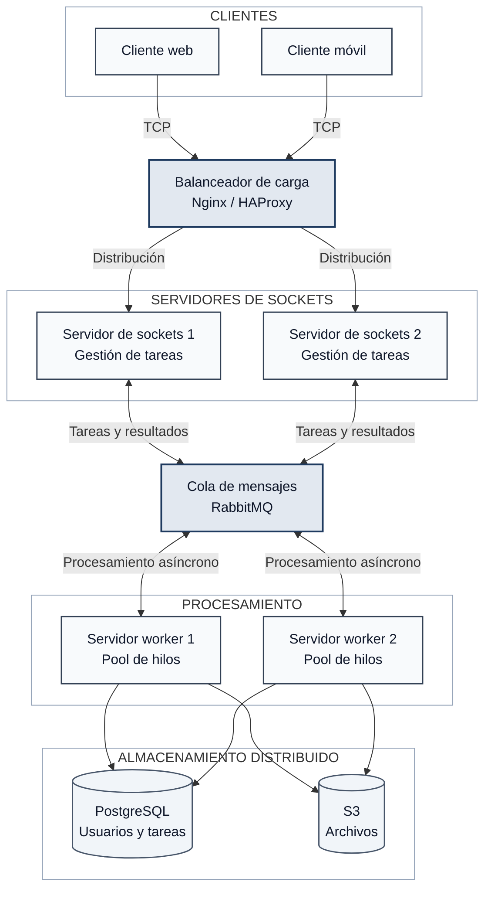

# PFO 3 - Sistema distribuido de tareas

Sistema cliente-servidor desarrollado en Python. El servidor recibe tareas mediante sockets TCP y las distribuye entre un pool de workers para procesarlas de forma concurrente.

Alumno:

- Leandro Melchiori - Comisión D

## Arquitectura



El diagrama representa el diseño completo solicitado. La implementación local se concentra en la comunicación por sockets y la distribución concurrente entre workers. RabbitMQ, PostgreSQL, S3 y el balanceador quedan definidos como la evolución necesaria para desplegar varias instancias.

## Estructura

```text
.
├── cliente.py             # Cliente de consola del PFO3
├── protocolo.py           # Intercambio de mensajes JSON por TCP
├── servidor.py            # Servidor y pool de workers
├── tests/                 # Pruebas del PFO3
├── pfo2/                  # Código y documentación de la entrega anterior
└── docs/                  # Documentación publicada con GitHub Pages
```

## Requisitos

- Python 3.10 o superior.
- `pip` disponible.

La aplicación utiliza solamente módulos de la biblioteca estándar de Python.

## Instalación

En PowerShell:

```powershell
py -m venv .venv
.\.venv\Scripts\Activate.ps1
py -m pip install -r requirements.txt
```

Para ejecutar las pruebas también se deben instalar las dependencias de desarrollo:

```powershell
py -m pip install -r requirements-dev.txt
```

## Ejecución

Iniciá el servidor:

```powershell
py servidor.py
```

De forma predeterminada escucha en `127.0.0.1:5000` y utiliza cuatro workers. Estos valores se pueden modificar:

```powershell
py servidor.py --host 0.0.0.0 --puerto 5000 --workers 4
```

En otra terminal, ejecutá el cliente:

```powershell
py cliente.py
```

El cliente permite convertir texto a mayúsculas, contar palabras y sumar números. Cada respuesta indica el worker que procesó la tarea.

## Protocolo

El cliente y el servidor intercambian un objeto JSON por conexión. Cada mensaje termina con un salto de línea para que el receptor pueda reconocer su final.

Ejemplo de solicitud:

```json
{
  "id": "identificador-de-la-tarea",
  "tarea": {
    "tipo": "contar_palabras",
    "texto": "programación sobre redes"
  }
}
```

Ejemplo de respuesta:

```json
{
  "ok": true,
  "id": "identificador-de-la-tarea",
  "resultado": {
    "tipo": "contar_palabras",
    "valor": 3,
    "worker": "worker_0"
  }
}
```

## Pruebas

```powershell
py -m pytest -q
```

Las pruebas verifican el procesamiento de tareas, el rechazo de datos incorrectos, la validación del protocolo y el recorrido completo entre el cliente, el servidor y los workers.

## Entrega anterior

El PFO2 se conserva en [`pfo2/`](pfo2/README.md), con su API Flask, cliente, pruebas y capturas originales.

## Documentación publicada

La documentación del PFO3 se publica mediante [GitHub Pages](https://leandromelchiori.github.io/PFO_Redes/). La versión anterior permanece disponible en la sección dedicada al PFO2.
